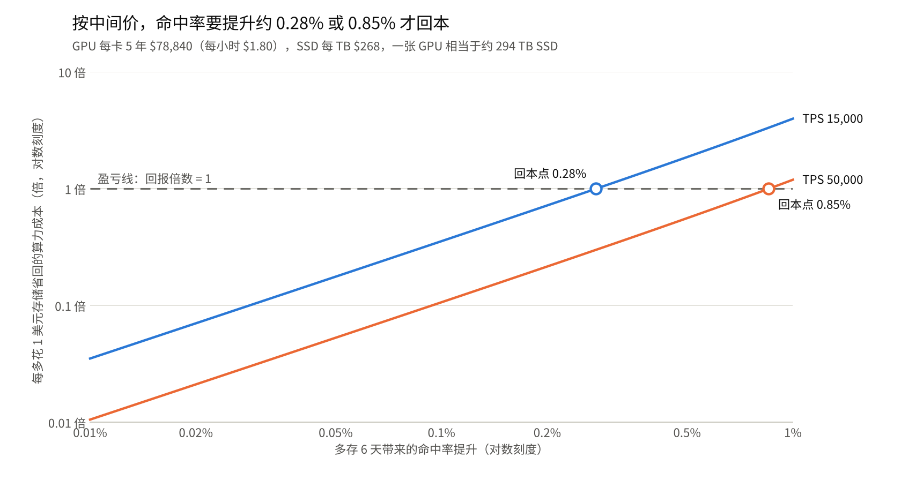

# 多存 6 天的回报倍数：超大规模买家、中间价口径

2026-11-13

## 结论

按超大规模买家的中间价，一张 GPU 相当于约 294 TB 的 SSD；多存 6 天要回本，命中率至少要提升约 0.28%（单卡 non-cache TPS 15,000）或 0.85%（TPS 50,000）。

不同提升幅度下的回报倍数，即每多花 1 美元存储省回多少美元算力，高于 1 才划算：

| 命中率提升 | TPS 15,000 | TPS 50,000 |
| --- | --- | --- |
| 0.05% | 0.18 | 0.05 |
| 0.1% | 0.36 | 0.11 |
| 0.2% | 0.72 | 0.22 |
| 0.5% | 1.87 | 0.56 |
| 1% | 3.98 | 1.20 |

- **提升 0.1% 时**两种 TPS 都不划算，只收回存储投入的一成到三成多。
- **TPS 越高越难回本**：重算越便宜，缓存命中省下的钱越少。
- **这是偏乐观的门槛**：未计入的因素多数会抬高门槛，见“敏感性”。

价格取的是不确定区间的中间值，全部假设见“相关假设”。

## 回报倍数图



图注：由本报告的公式计算，命中率提升 0.01%–1%，超大规模买家、价格取中间值。

曲线在虚线上方的区段即划算，圆圈是回本点。图中用到的价格：

- **GPU**：每卡每小时全成本 $1.80，5 年共 $78,840。取 SemiAnalysis 对 B200（$1.73）和 GB200（$1.86）超大规模自有口径的中间值。
- **SSD**：每 TB 全成本 $268，其中盘价 $200（合约价口径 $150–250 的中间值），机箱和电费等 $68（假设）。
- **换算**：$78,840 ÷ $268 ≈ 294，即一张 GPU 相当于约 294 TB 的 SSD。

## 相关假设

价格统一按超大规模买家、自有设备取值，不确定的项目取区间中间值。

### 价格

| 项目 | 中间值 | 原区间 | 依据 |
| --- | --- | --- | --- |
| GPU 每卡每小时全成本 | $1.80 | $1.73–1.86 | SemiAnalysis 对 [B200](https://inferencex.semianalysis.com/chips/b200) 和 [GB200 NVL72](https://inferencex.semianalysis.com/chips/gb200-nvl72) 的超大规模自有口径，含服务器购置、电费、托管和资金成本 |
| GPU 5 年全成本 | 每卡 $78,840 | $75,800–$81,500 | 每小时成本 × 43,800 小时 |
| SSD 盘价 | 每 TB $200 | $150–250 | 2026 年底合约价口径。下限取自 [memoryindex](https://memoryindex.io/ssd-prices) 对 30.72 TB QLC 企业盘的推算价（每块 $4,635），上限为 TLC 的粗略估计 |
| SSD 机箱、电费等 | 每 TB $68 | 约 $65 | 假设 |
| SSD 全成本 | 每 TB $268 | $215–320 | 以上两项相加 |
| 一张 GPU 相当于 | 约 294 TB SSD | 240–380 TB | GPU 5 年全成本 ÷ SSD 每 TB 全成本 |

### 买家和设备

- **买家类型**：超大规模买家，自有设备，GPU 和 SSD 都按 5 年折旧。
- **GPU 型号**：Blackwell 一代，即 B200 或 GB200。DeepInfer 开源仓库的基准写明跑在 SM100 上，这是 CUDA 对[数据中心版 Blackwell 的架构代号](https://developer.nvidia.com/cuda/gpus.md)，与成本数字的型号一致。
- **未考虑**国内采购的溢价。若 GPU 实际更贵，多存会更划算。

### 场景

- **基准**：存 1 天时缓存命中率 90%。
- **延长**：再多存 6 天，共 7 天。
- **命中率提升**：按百分点计，范围 0.01%–1%。
- **单卡 non-cache TPS**：15,000 和 50,000，按线上有效吞吐理解。

### 存储占用

- **每 token 的 KV**：0.9 KB 逻辑大小，乘 1.2 倍纠删码，即 1.075 KB 物理占用。由媒体报道的 112 KiB 块大小除以 128 token 得出，针对 DeepSeek V4.1 Flash，可信度低。
- **写入量**：只计未命中的输入 token，未计输出 token。

## 敏感性

取中间值是为了得到一条清晰的曲线，不确定性仍然存在；下表是单独改变一项输入时的回本门槛。

| 情形 | TPS 15,000 | TPS 50,000 |
| --- | --- | --- |
| 中间价（基准） | 0.28% | 0.85% |
| SSD 每 TB $215（区间下限） | 0.22% | 0.70% |
| SSD 每 TB $320（区间上限） | 0.33% | 1.00% |
| SSD 每 TB $803（VDURA 指数的 TLC 盘价加机箱） | 0.78% | 2.1% |
| 每 token 的 KV 为 3 倍 | 0.78% | 2.1% |
| 计入输出 token（输出量为输入的 10%） | 0.55% | 1.7% |
| 基础命中率 80% 而非 90% | 0.55% | 1.7% |

- **SSD 价格是最大的不确定项。** 不同来源对 2026 年盘价的说法相差 4–5 倍，合约价口径本身是推算值。
- **后三项都朝不利方向移动**，所以基准门槛应理解为偏乐观的估计。
- **TPS 的口径**：若 15,000 和 50,000 是离线峰值，线上有效吞吐更低，门槛会相应下降。

## 套到 DeepSeek 披露的情形

DeepSeek 披露的是 chat 留存从 7 天缩到约 3 天会损失 0.5%–1% 的命中率。按同样的中间价、TPS 50,000，从 3 天延长到 7 天要回本，基础命中率需达到：

| 命中率提升 | 回本所需的基础命中率（3 天时） |
| --- | --- |
| 0.5% | 高于约 91% |
| 1% | 高于约 82% |

基础命中率越高，写入存储的 token 越少，多留 4 天多占的空间也越少，所以越容易回本。DeepSeek 未公布命中率；由存储容量和 prefill 产能做的间接推算在 75%–92% 之间，是全集群口径。据此，提升取 1% 时多半成立，取 0.5% 时处在边缘。TPS 50,000 落在 DeepInfer 离线基准折算后的线上范围（约 2.9 万–5.7 万）之内。

## 算法

回报倍数等于省下的重算成本除以多花的存储成本。

设每天输入 token 量为 F，命中率提升为 d（小数）：

1. **多出的存量**：（0.10 − d）× 7 × F 减去 0.10 × F，等于（0.60 − 7d）× F 个 token。
2. **省下的算力**：每天少重算 d × F 个 token，相当于 d × F ÷（TPS × 86,400）张 GPU。
3. **临界比值** X*：两边成本相等时，一张 GPU 需相当于的 SSD 容量。

```
X* = (0.60 − 7d) / d × b × TPS × 86,400
```

其中 b 是每 token 的物理占用，取 1.075 KB。

4. **回报倍数**：294 TB 除以 X*。
5. **回本门槛**：令回报倍数等于 1，解出 d。

算例：TPS 15,000、提升 0.1% 时，每省一个 token 的重算要多存 593 个 token，X* 约 826 TB，回报倍数为 294 ÷ 826 ≈ 0.36。

## 来源

- [SemiAnalysis InferenceX：B200](https://inferencex.semianalysis.com/chips/b200)
- [SemiAnalysis InferenceX：GB200 NVL72](https://inferencex.semianalysis.com/chips/gb200-nvl72)
- [NVIDIA：CUDA GPU Compute Capability](https://developer.nvidia.com/cuda/gpus.md)
- [memoryindex：SSD 价格追踪](https://memoryindex.io/ssd-prices)
- [StorageReview：企业 SSD 价格（VDURA 指数）](https://www.storagereview.com/news/enterprise-ssd-prices-run-at-6-5x-last-year-vdura-pegs-a-30tb-tlc-drive-at-22600)
- [DeepInfer 官方开源仓库](https://github.com/deepseek-ai/DeepInfer)及其[部署问答文档](https://github.com/deepseek-ai/DeepInfer/blob/main/doc/inference_deployment_qa.md)
- [InfoQ：DeepSeek 开源最新推理框架](https://infoq.cn/article/NBXP966Bz3eqr6Qidvaf?amp=)

SemiAnalysis 的 B200 页面和 DeepInfer 的两个页面打开过全文，其余取自搜索结果摘要。
