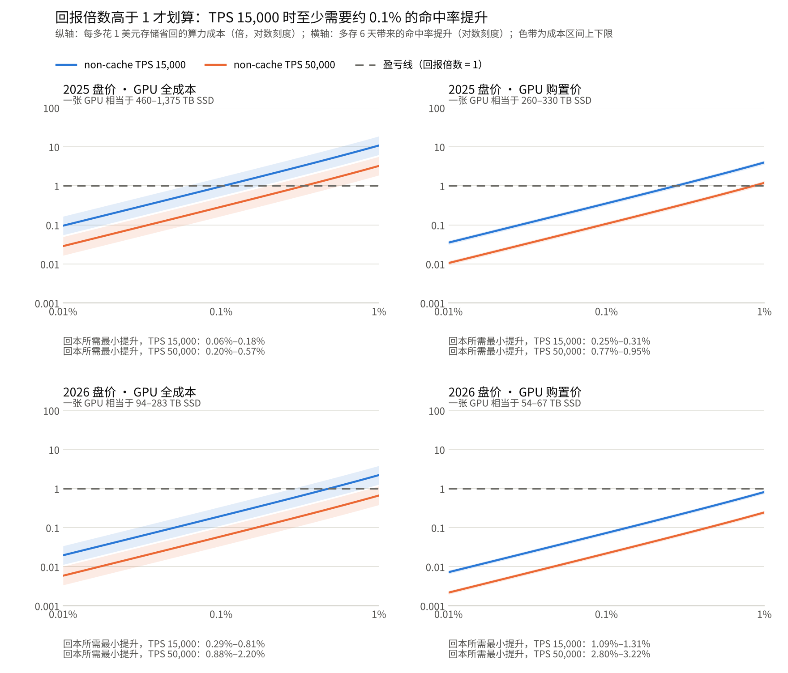

# 多存 6 天换命中率提升是否划算：按 non-cache TPS 的回报倍数分析

2026-11-13

## 结论

在“存 1 天命中率 90%、再多存 6 天”的场景下，单卡 non-cache TPS 为 15,000 时，命中率至少要提升约 0.06%–0.18% 才能回本，这还是最有利的成本口径；按 2026 年盘价需要 0.3% 以上。

回本所需的最小命中率提升（百分点）：

| 成本口径 | TPS 15,000 | TPS 50,000 |
| --- | --- | --- |
| 2025 盘价，GPU 全成本 | 0.06%–0.18% | 0.20%–0.57% |
| 2025 盘价，GPU 购置价 | 0.25%–0.31% | 0.77%–0.95% |
| 2026 盘价，GPU 全成本 | 0.29%–0.81% | 0.88%–2.2% |
| 2026 盘价，GPU 购置价 | 1.1%–1.3% | 2.8%–3.2% |

- **读法**：0.1% 表示命中率从 90% 升到 90.1%。实际提升高于表中数值就划算。
- **区间**：来自每种口径下 GPU 成本的上下限，具体金额见“图中使用的 GPU 和 SSD 价格”。
- **TPS 的影响**：TPS 越高重算越便宜，门槛大致按 TPS 等比例上升。
- **提升 0.1% 时**：只有 TPS 15,000 在“2025 盘价、GPU 全成本”口径下可能回本，其余组合都不划算。

本报告是假设情形下的推算，所有结论依赖“场景与假设”中的输入。

## 场景与假设

这是一个设定的场景，不对应某家厂商的实测数据。

| 输入 | 取值 | 性质 |
| --- | --- | --- |
| 基准留存 | 存 1 天，缓存命中率 90% | 场景设定 |
| 延长留存 | 再多存 6 天，共 7 天 | 场景设定 |
| 命中率提升 | 0.01%–1%（百分点） | 分析的自变量 |
| 单卡 non-cache TPS | 15,000 和 50,000 | 场景设定，按线上有效吞吐理解 |
| 每 token 的 KV | 0.9 KB 逻辑大小，乘 1.2 倍纠删码，即 1.075 KB 物理占用 | 估算。由媒体报道的 112 KiB 块大小除以 128 token 得出，针对 DeepSeek V4.1 Flash，可信度低 |
| 写入量 | 只计未命中的输入 token | 简化假设，未计输出 token |
| 折旧期 | GPU 和 SSD 都按 5 年 | 假设 |

延长留存后，每天写入量随命中率上升而略减，计算中已考虑。

## 回报倍数图



图注：由本报告的公式计算，命中率提升 0.01%–1%，四种成本口径；实线取成本区间的几何中点，色带为区间上下限。

曲线高于虚线的区段即划算；四个小图的坐标范围相同。图中用到的价格：

- **GPU 全成本**：每卡 5 年 $75,800–$226,900，即每卡每小时 $1.73–5.18 乘 43,800 小时，含购置、电费、托管和资金等。
- **GPU 购置价**：每卡 $43,100–$54,200，即 GB200 NVL72 整机柜 $310 万–$390 万除以 72 张卡，只含硬件。
- **SSD，2025 盘价**：每 TB $165，即 30 TB TLC 企业盘 $3,460（每 TB $115）加机箱等每 TB $50。
- **SSD，2026 盘价**：每 TB $803，即同款盘 $22,600（每 TB $753）加机箱等每 TB $50。

小图标题下的“一张 GPU 相当于多少 TB SSD”由 GPU 成本除以 SSD 每 TB 成本得到。

## 图中使用的 GPU 和 SSD 价格

四种成本口径由两档 GPU 成本和两档 SSD 盘价组合而成，全部是第三方数据或假设。

| 项目 | 金额 | 算法与来源 |
| --- | --- | --- |
| GPU 全成本 | 每卡 $75,800–$226,900（5 年） | 每卡每小时 $1.73–5.18 × 43,800 小时。$1.73 是 [SemiAnalysis](https://inferencex.semianalysis.com/chips/b200) 对 B200 的超大规模厂商全成本测算，含服务器购置、电费、托管和资金成本；$5.18 是[第三方文章](https://vkambati.substack.com/p/the-38-gpu-hour)引用的自建 B300 机柜测算，含电力、托管、人员、维保、故障和资金 |
| GPU 购置价 | 每卡 $43,100–$54,200 | GB200 NVL72 整机柜 $310 万–$390 万 ÷ 72 张卡，取自一份[汇总资料](https://research-viewer.pages.dev/orbital-ai-datacenters-3/pages/gpu-cost-per-kw/)；只含硬件 |
| SSD，2025 盘价 | 每 TB $165 | 30 TB TLC 企业盘 2025 年三季度 $3,460，折合每 TB $115；加机箱等每 TB $50（假设） |
| SSD，2026 盘价 | 每 TB $803 | 同款盘 2026 年三季度 $22,600，折合每 TB $753；加机箱等每 TB $50（假设）。盘价取自 [VDURA 指数的报道](https://www.storagereview.com/news/enterprise-ssd-prices-run-at-6-5x-last-year-vdura-pegs-a-30tb-tlc-drive-at-22600) |

由此得到每个小图标题下的换算值，即一张 GPU 相当于多少 TB 的 SSD：

| 成本口径 | GPU 成本（每卡） | SSD 成本（每 TB） | 一张 GPU 相当于 |
| --- | --- | --- | --- |
| 2025 盘价，GPU 全成本 | $75,800–$226,900 | $165 | 460–1,375 TB |
| 2025 盘价，GPU 购置价 | $43,100–$54,200 | $165 | 260–330 TB |
| 2026 盘价，GPU 全成本 | $75,800–$226,900 | $803 | 94–283 TB |
| 2026 盘价，GPU 购置价 | $43,100–$54,200 | $803 | 54–67 TB |

- **型号不一致**：两个全成本数字分别针对 B200 和 B300，购置价针对 GB200，均非同一型号的实测。
- **口径不完全对称**：SSD 只算了购置，未计电费和机房；“GPU 全成本”口径因此略偏向多存划算。
- **盘价是市场指数**，不是某家厂商的实际采购价。

## 算法

回报倍数等于省下的重算成本除以多花的存储成本，高于 1 即划算。

设每天输入 token 量为 F，命中率提升为 d（小数）：

1. **多出的存量**：存 7 天时的存量（0.10 − d）× 7 × F，减去存 1 天时的 0.10 × F，等于（0.60 − 7d）× F 个 token。
2. **省下的算力**：每天少重算 d × F 个 token，相当于 d × F ÷（TPS × 86,400）张 GPU。
3. **临界比值**：两边成本相等时，一张 GPU 需相当于的 SSD 容量。

```
X* = (0.60 − 7d) / d × b × TPS × 86,400
```

其中 b 是每 token 的物理占用，取 1.075 KB。

4. **回报倍数**：实际的“一张 GPU 相当于多少 TB SSD”除以 X*。
5. **回本门槛**：令回报倍数等于 1，解出 d。

算例：TPS 15,000、提升 0.1% 时，每省一个 token 的重算要多存 593 个 token，X* 约 826 TB。按“2025 盘价、GPU 全成本”的 460–1,375 TB，回报倍数约 0.56–1.66。

## 未计入的因素与不确定性

以下因素都会让回本门槛明显移动，多数是朝不利方向。

- **每 token 的 KV 大小**：门槛与它成正比。0.9 KB 是针对 DeepSeek V4.1 Flash 的低可信度估算；若实际为 3 倍，表中门槛约乘 3。常规稠密大模型可达每 token 数百 KB。
- **输出 token 的写入**：模型输出也会写入存储。若输出量相当于输入的 10%，多出的存量约翻倍，门槛也约翻倍。
- **命中率基数**：基数若是 80% 而非 90%，写入量翻倍，门槛约为现在的 2.2 倍。
- **TPS 的口径**：若 15,000 和 50,000 是离线峰值，线上有效吞吐更低，门槛会相应下降。
- **价格输入**：GPU 成本来自不同型号的第三方测算，SSD 机箱成本是假设。
- **命中率提升本身**：多存 6 天能带来多少提升，需要实测。公开数据只有 DeepSeek 披露的一个点：chat 从 7 天缩到约 3 天损失 0.5%–1%。

## 来源

- [SemiAnalysis InferenceX：B200](https://inferencex.semianalysis.com/chips/b200)
- [The $38 GPU-Hour（Substack）](https://vkambati.substack.com/p/the-38-gpu-hour)
- [GPU Cost per kW_IT 汇总](https://research-viewer.pages.dev/orbital-ai-datacenters-3/pages/gpu-cost-per-kw/)
- [StorageReview：企业 SSD 价格（VDURA 指数）](https://www.storagereview.com/news/enterprise-ssd-prices-run-at-6-5x-last-year-vdura-pegs-a-30tb-tlc-drive-at-22600)
- [DeepInfer 官方开源仓库的部署问答文档](https://github.com/deepseek-ai/DeepInfer/blob/main/doc/inference_deployment_qa.md)
- [InfoQ：DeepSeek 开源最新推理框架](https://infoq.cn/article/NBXP966Bz3eqr6Qidvaf?amp=)

价格类来源中，Substack 文章和 DeepInfer 文档打开过全文，其余取自搜索结果摘要。
